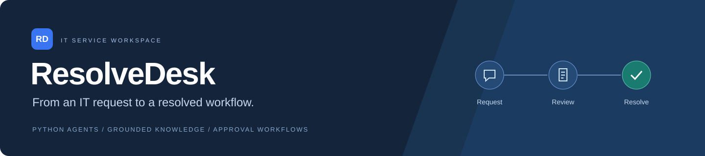
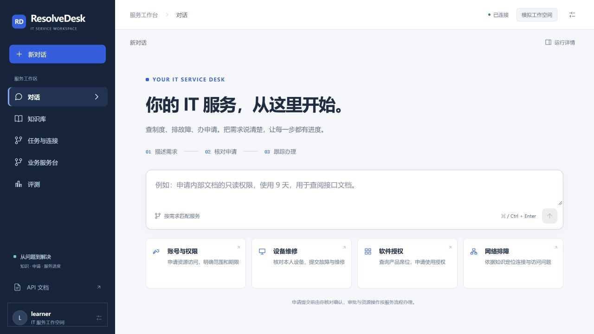
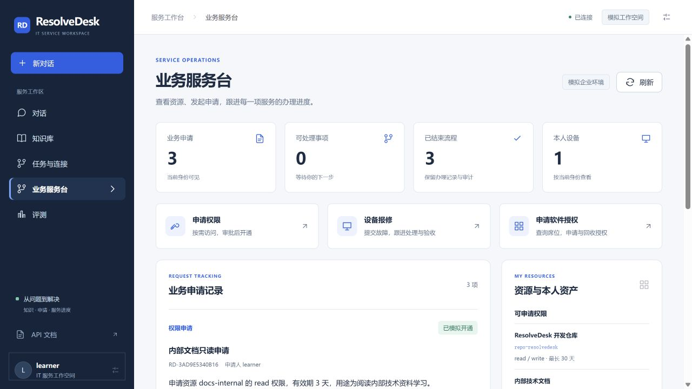
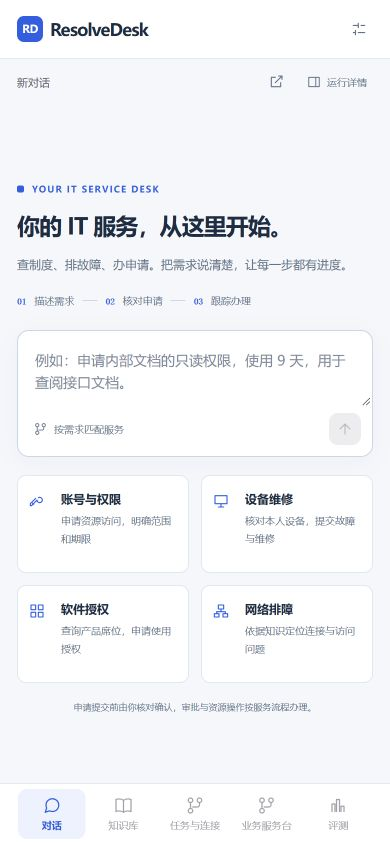
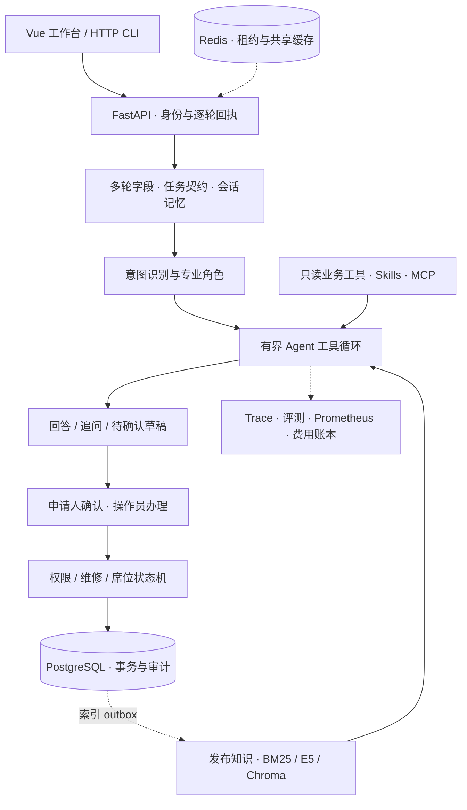

<div align="center">
  
  <p><strong>把员工的 IT 诉求，变成有依据、可确认、可追踪的服务流程。</strong></p>
  <p>
    <a href="https://github.com/exIncognitor/ResolveDesk/actions/workflows/ci.yml"></a>
    <a href="docs/GETTING_STARTED.md"></a>
    <a href="frontend/package.json"></a>
    <a href="LICENSE"></a>
  </p>
  <p><a href="#preview">界面预览</a> · <a href="#quick-start">快速开始</a> · <a href="#architecture">系统架构</a> · <a href="docs/README.md">项目文档</a> · <a href="https://github.com/exIncognitor/ResolveDesk/releases">版本发布</a></p>
</div>

ResolveDesk 是一个面向企业内部 IT 服务的 Python Agent 应用。员工通过对话查询制度、排查故障、准备申请；服务人员在工作台审批、处理和验收。知识检索、多角色协作与业务状态围绕同一项服务连接起来。

项目覆盖 **账号权限、网络终端、软件授权、设备服务**，提供权限开通、设备维修、软件席位三条持久化业务闭环。内置企业制度、账号资源和资产为模拟数据，适合本地体验、工程实践和二次开发。

<a id="preview"></a>
## 界面预览



<details>
<summary><strong>业务服务台：申请记录、处理状态与本人资源</strong></summary>



服务概览由当前身份可见的业务记录计算；每张单保留状态、操作人、处理说明和审计记录。

</details>

<details>
<summary><strong>手机布局</strong></summary>



</details>

## 能完成哪些服务

| 场景 | 示例需求 | 办理结果 |
| --- | --- | --- |
| 账号与权限 | “申请内部文档只读权限，使用9天。” | 核对草稿 → 确认 → 其他操作员批准 → 模拟开通有效权限 |
| 设备维修 | “我的 LT-1001 键盘失灵，需要报修。” | 本人资产核验 → 分诊派单 → 处理 → 本人验收或返工 |
| 软件授权 | “需要 IDEA Ultimate 五天，用于阅读项目代码。” | 查询实时席位 → 审批 → 预占 → 分配 → 到期或主动回收 |
| 网络与终端 | “VPN 错误691怎么排查？” | 检索适用知识 → 专业诊断建议 → 可追溯引用与必要追问 |

三条流程的角色、操作步骤和状态变化见 [业务演示](docs/BUSINESS_DEMOS.md)。

## 工程亮点

- **从对话到可确认申请**：保存用户明确给出的资源、设备、期限和用途；支持字段更正、取消和补充信息。模型准备草稿，授权接口完成确认、审批与资源操作。
- **带发布治理的混合 RAG**：Markdown 原文跨度分块，BM25 + 本地 E5 + Chroma + RRF；文档经历草稿、审核、发布和撤回，引用按当前身份、版本与有效期复核。
- **有界多角色协作**：三路意图融合连接账号权限、技术诊断、软件授权和升级角色；普通及复合请求保留实际执行节点、工具结果和回退轨迹。
- **可恢复执行与事务状态**：逐轮幂等回执、模型/工具检查点、Redis 租约与 SQL 执行代次；业务动作结合版本检查、资源行锁和事务审计。
- **会话记忆与标准工具接入**：可追溯摘要、画像和私有情景召回；按角色加载 Skills，支持 MCP stdio / Streamable HTTP，并提供鉴权的知识 MCP 服务。
- **评测、监控和费用控制**：隔离的业务质量评测、逐轮断言与辅助 Judge；持久指标、Prometheus 和告警 outbox；各进程共用模型费用账本。

<a id="architecture"></a>
## 系统架构



| 层 | 技术与责任 |
| --- | --- |
| 界面与接口 | Vue 3 / Vite、FastAPI、SSE、HTTP CLI |
| 模型与检索 | DeepSeek Flash、本地固定版本 multilingual-e5-small、BM25、RRF |
| 状态与数据 | PostgreSQL、SQLAlchemy 连接与事务、Redis、Chroma |
| 工具与运行 | MCP Python SDK、角色工具白名单、Skills、执行检查点 |
| 交付与观测 | Docker Compose、Nginx、Prometheus、GitHub Actions |

详细调用链和选型见 [当前架构](docs/CURRENT_ARCHITECTURE.md)。

<a id="quick-start"></a>
## 快速开始

准备 **Python 3.12、Node.js 22.12+、Docker Desktop / Compose**。可在宿主机调试 Python，用 Docker 管理 PostgreSQL、Redis、Chroma。

```powershell
git clone https://github.com/exIncognitor/ResolveDesk.git
cd ResolveDesk
python -m venv .venv
.\.venv\Scripts\Activate.ps1
python -m pip install -r requirements-dev.txt
```

接着按 [首次启动指南](docs/GETTING_STARTED.md) 初始化本地依赖、模型和访问令牌，构建前端后启动服务。指南包含 Windows 和 Linux/macOS 命令。

- 宿主机工作台：`http://127.0.0.1:8080`
- 完整 Compose 网关：`http://127.0.0.1:18080`
- 接口文档：`/docs`；依赖检查：`/ready`
- CLI：`python -m resolvedesk.cli --base-url http://127.0.0.1:8080 --actor learner`

模型仅使用 `deepseek-flash`，Key 保存在本地 `.env`；页面使用本应用访问令牌。收费调用默认关闭，首次启用前配置自己的账号与预算。

## 验证与质量

| 验证层 | 已记录结果 | 证据 |
| --- | --- | --- |
| 前端行为回归 | 42项通过，包含身份/会话切换与SSE竞态 | [前端测试](frontend/tests) |
| 真实依赖集成 | 463项测试及14子测试通过 | [服务回归报告](reports/final-polish-services-tests.xml) |
| 浏览器业务演示 | 权限、维修、席位三条闭环，落库复核11/11 | [业务证据](reports/final-polish-ui-workflows.json) |
| 真实 Flash 复验 | 同12组合成对话两轮硬检查均12/12；含Judge分别11/12、10/12 | [第一轮](reports/iteration4-final-polish-live-r1.json) / [第二轮](reports/iteration4-final-polish-live-r2.json) |

上述质量记录对应 `resolvedesk-demo-v1` 的业务引擎。当前界面重设计另做前端回归和桌面/手机核验。固定合成题用于项目回归，原始失败与评分均保留；实验设置见 [验收报告](docs/FINAL_POLISH_ACCEPTANCE.md)。

```powershell
python -X utf8 -B -m pytest -q
npm --prefix frontend test
npm --prefix frontend run build
```

默认测试使用受控模型，不产生真实 API 费用。真实服务集成和付费评测分开启用，说明见 [开发与验证](docs/DEVELOPMENT.md)。

## 文档导航

| 我想了解 | 入口 |
| --- | --- |
| 从新机器启动 | [首次启动指南](docs/GETTING_STARTED.md) |
| 体验三条完整流程 | [业务演示](docs/BUSINESS_DEMOS.md) |
| 沿代码理解架构 | [当前架构](docs/CURRENT_ARCHITECTURE.md) |
| 导入、审核和发布知识 | [知识发布操作](docs/KNOWLEDGE_PUBLICATION.md) |
| 了解模块覆盖与技术范围 | [功能清单](docs/FEATURE_STATUS.md) · [技术范围](docs/TECHNICAL_SCOPE.md) |
| 接入 MCP 或使用 CLI | [MCP接入](docs/MCP_MIGRATION_2026-10-27.md) · [API与CLI](docs/API_CLI_MIGRATION_2026-10-27.md) |
| 查看历史实验与交付证据 | [文档中心](docs/README.md) |

## 参与开发

欢迎提交可复现的问题、知识与工作流改进。开始前阅读 [贡献指南](CONTRIBUTING.md)，给出具体输入、预期状态和观察结果。

项目当前使用模拟企业数据。真实 IAM、维修平台、厂商席位接入及外部告警送达属于后续集成范围。

## License

[MIT](LICENSE)
