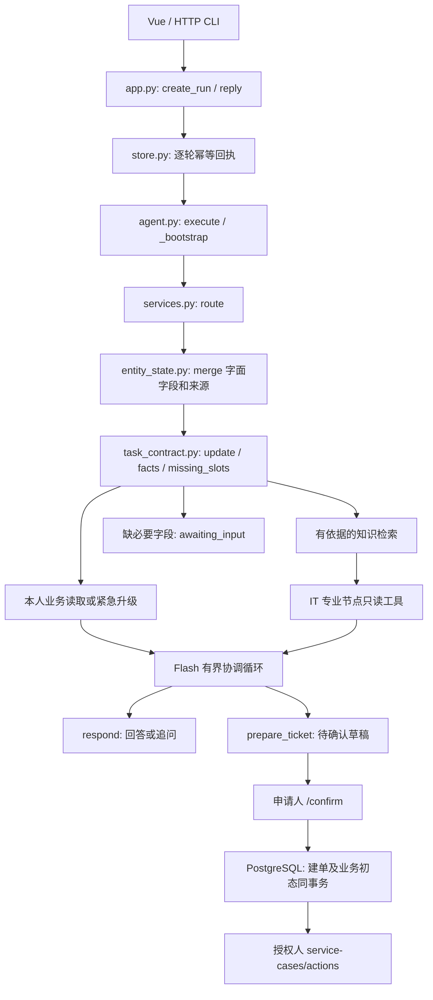

# ResolveDesk 当前架构与代码导读

更新：2026-10-28，第四轮执行契约和知识治理。本文是当前架构入口；各轮验收报告描述各自固定版本，不能用旧报告代替当前运行验证。

## 业务与技术边界

面向企业内部 IT 服务台，覆盖账号权限、网络终端、软件授权、设备服务四类场景。三条有持久状态变化的流程为权限申请、设备维修、商业软件席位。企业制度、资产、权限和席位均为明确标注的模拟数据；没有对接真实 IAM、维修商或厂商许可证服务。Agent 的价值是结合知识、本人业务状态与多轮输入，收集可审计的申请，再由授权人确认和办理。

后端仅 Python；Vue 是同源工作台，CLI 使用相同 HTTP 接口。PostgreSQL 保存事务事实，Redis 协调跨进程租约与共享缓存，Chroma 保存可重建的知识和私有记忆向量投影，本地固定 E5 提供向量，DeepSeek Flash 提供语言与专业节点推理。SQLite 只用于显式离线测试。Docker 可启动依赖或整套服务，开发时 Python 也可直接运行在宿主机。

## 一次请求实际走哪里

1. `resolvedesk/app.py:create_app` 绑定身份、接口、SSE 和 Vue 静态资源。`resolvedesk/store.py:create_run/reply` 对每个请求键保存输入哈希、状态、事件范围和结果；相同键和不同输入冲突。
2. `resolvedesk/agent.py:execute` 在 Redis 和 SQL 执行代次保护下处理；`_bootstrap` 调用 `DeskServices.route`，而不是先无条件要求知识充分。三路意图融合决定专业角色；`EntityState.merge` 合并明确字段、纠错、清除与任务切换；`task_contract.update` 单独记录申请类型和用户同意，模型分类不等于申请同意。
3. `task_contract.facts` 区分问候、业务事实、紧急交接、申请和知识。本人资产/工单不依赖知识门禁，知识建议仍要求当前可用依据；申请缺关键字段由服务端直接追问并保存 `awaiting_input`。专业节点按当前身份读知识和业务，模型不能审批或分配资源。
4. 协调循环使用 `respond(answer|clarify)`、读工具和 `prepare_ticket`。准备草稿时，资源、资产、权限和期限以字面来源覆盖模型参数；workflow/category 以服务端任务契约为准。派生摘要单独标为模型派生。模型遗漏或写错 workflow 不能让专用申请退化为普通工单。
5. `Store.confirm` 校验精确草稿、有效期和身份，同事务建工单并调用 `BusinessService.materialize`。提交后可继续同会话查询，但不能在该会话准备另一张工单；新申请用新会话。取消未提交草稿会清除本次申请；取消已提交工单必须走业务操作接口，聊天不会冒称已撤销资源。
6. `BusinessService.transition` 和 `resolvedesk/licenses.py` 校验参与者、版本、幂等键与业务政策，以事务推进实际模拟状态。三个流程的演示见 [业务演示和讲解](BUSINESS_DEMOS.md)。

## 知识与记忆为什么分开

`HybridKnowledge` 对有权读取且当前发布有效的正文做 BM25/E5/Chroma/RRF 检索。`knowledge_governance.py` 用 PostgreSQL 状态和数据库时钟作最终过滤；Chroma 是投影，outbox 延迟不应扩大权限。缓存和最终引用继续核验当前权限、版本及发布状态。新导入无论有无元数据均为草稿；一次性迁移仅登记上线前的存量版本，后续重启不会把新材料当成旧材料。存量纳管保留正文、内容版本和引用 ID。

记忆保存对话摘要、画像依据和本人历史，不是企业制度依据。它有独立私有向量集合与有界后台维护；知识发布与个人记忆的生命周期不能互换。MCP 只暴露经过鉴权的读取工具/资源，模型没有审核发布入口。详细操作见 [知识发布](KNOWLEDGE_PUBLICATION.md)。

## 恢复、事件循环和测量

SQL 回执和模型/工具检查点用于恢复已完成步骤。评测通过 EvalState.unit 禁止自动重放不确定的付费单元；普通聊天在模型完成但检查点尚未保存时中断，显式恢复仍可能重发并再次收费。Redis 协调租约和 SQL owner/epoch 一起阻止旧执行者写入。SSE 对当前轮次持续读 SQL 事件，已测得的慢 SQL 热点局部移到线程，包括 SSE 每轮读和主循环工单读取；同步业务存储层整体仍保留，不能声称全链路异步数据库。受控 `pg_sleep(.12)` 测试的心跳间隔改善只证明这两个热点不再同样阻塞事件循环，不是吞吐基准。

当前质量入口是 `resolvedesk/quality.py:QualityRunner.run`：冻结原始知识和发布语义，经隔离 PG/Redis/Chroma、实际 ASGI 路径执行多轮对话、确认及业务操作。suite 身份包含规范化发布元数据；源码 engine 身份单列，元数据变化不能沿用旧基线。硬指标为状态、字面实体、实际工具调用、写入和生命周期，Judge 辅助分数独立展示。旧 schema 报告保留，不能跨评分合同直接比较。

监控基于执行代次、实际角色、工具和检索；Prometheus 采集持久指标，告警本地 outbox 可验。外部 Webhook 按用户选择未配置，真实外部送达尚未验收。

## 技术取舍和未覆盖项

这是适合学习工程边界的单后端架构，暂不引入新的编排框架、专用重排服务或消息基础设施。Redis/Chroma 分别负责协调和向量，不替代 SQL 的确认事务。知识充分性由检索信号判断，仍会保守追问或发生误判；合成验收不能证明真实公司问题的泛化。通用多语言输入、自然语言取消的无限表达、真实外部系统接入和生产容量都不在“已完全验证”之列。
