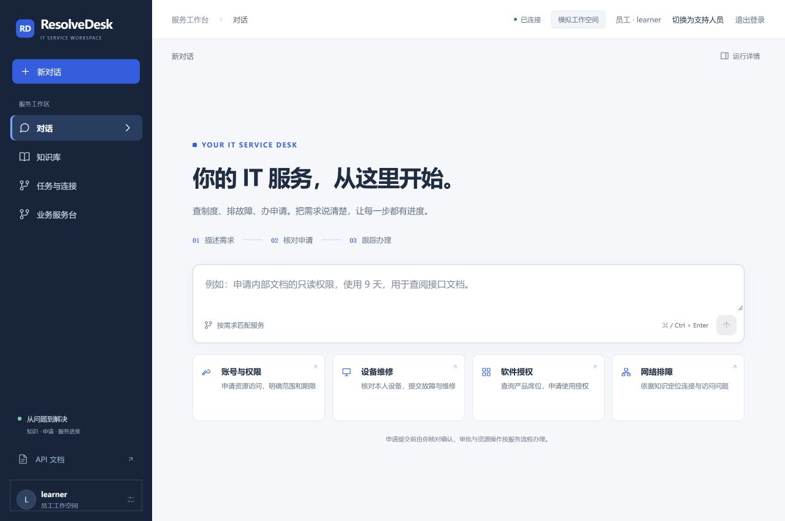
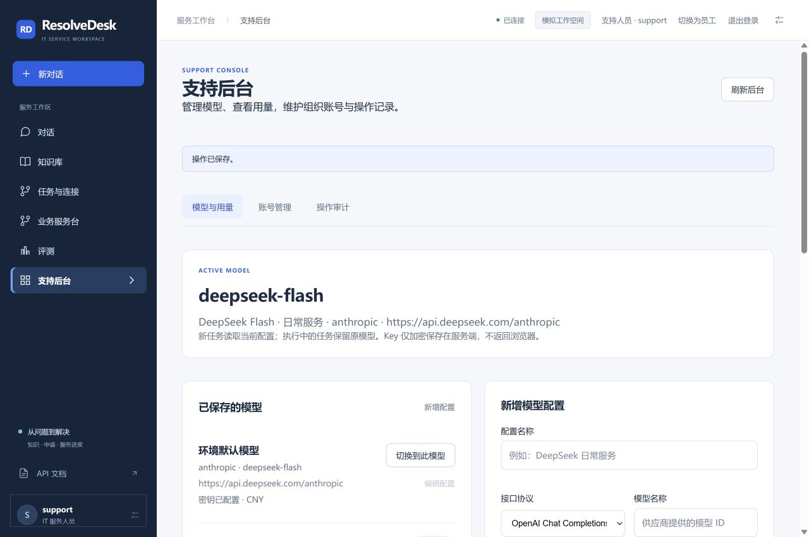

# 登录与企业内部服务验收

[项目首页](../README.md) · [模型与身份配置](MODEL_CONFIGURATION.md) · [企业使用范围](ENTERPRISE_READINESS.md)

2026-10-29，本轮完成账号登录、员工与支持人员的功能隔离、支持模型后台和系统内部授权/工单生命周期。按当前业务范围保留两个角色；没有引入更细的审批组织层级。

## 现在如何体验

本机Docker网关为 `http://127.0.0.1:18080/`。登录页面可输入组织、账号和密码。首次初始化的密码写入本机 `.codex-runtime/login-accounts.json`，不随仓库发布。执行 `python -m tools.setup_identity` 可在新环境创建初始账号，不会重置已有账号和业务数据。

当前本地环境显式开启开发测试入口：可直接选择员工或支持人员，登录后也可快速切换。生产环境在服务端禁用该功能。员工看不到模型、评测和账号管理入口；直接调用管理接口也返回403。

## 完成的变化

| 范围 | 行为与边界 |
| --- | --- |
| 登录 | PBKDF2密码摘要、随机8小时会话、会话摘要落库、退出与逐请求撤销校验、连续失败锁定、网关登录限流 |
| 账号后台 | support创建账号、启用/停用、撤销全部会话；保留操作审计；不能停用当前管理账号 |
| 模型后台 | 维护协议、模型、地址、API Key与可选单价；支持多配置切换和返回环境默认配置；Key加密落库且不返回浏览器 |
| 调用与用量 | 每个任务固定配置；新任务使用最新配置；先持久化调用记录，再记录usage与结算结果；失败和结算异常不触发请求重放 |
| 费用显示 | 每次调用保存单价快照；按实际Token估算；缺少价格或usage显示未知；币种分别汇总；没有累计预算闸门 |
| 权限生命周期 | 按申请保留授权来源；合并权限但不延长更高权限期限；按来源撤销；到期、降级和账号停用回收 |
| 维修与离职处理 | 从同租户启用的支持人员目录派单/转派；实际处理人开始和解决；停用申请人后保留未修设备占用，支持显式审计代验收 |
| 账号停用闭环 | 同事务撤销身份与有效授权、回收席位、取消未完结资源申请、暂停/围栏化未结束Agent执行；业务记录与审计保留 |

两种角色的详细职责和生产配置见[配置说明](MODEL_CONFIGURATION.md)。support同时承担系统管理职责，应分配给受信任的IT管理人员。当前没有公开注册、企业SSO或邮件找回密码。

## 本轮验证

| 验证 | 结果 | 证据 |
| --- | --- | --- |
| 真实PG/Redis/Chroma后端回归 | 493通过，14子测试通过 | [最终JUnit报告](../reports/enterprise-login-models-final.xml) |
| 前端行为回归与构建 | 53通过，Vite构建成功 | [前端测试](../frontend/tests) |
| 发布凭据扫描针对性测试 | 3通过，覆盖未知前缀Key、登录密码与主加密密钥 | [测试代码](../tests/test_release_scan.py) |
| 部署接口验收 | 34/34通过 | [脱敏JSON](../reports/enterprise-login-deployment-20261029T111316874877Z.json) |
| 浏览器操作验收 | 14/14通过 | [脱敏JSON](../reports/enterprise-login-ui.json) |

部署运行源码为 `4fd544a`；后续变化限于发布检查工具、验收与文档。接口验收覆盖真实密码登录、未登录拒绝、员工管理读写拒绝、support可见内容、密钥加密与脱敏、当前前端静态资源、退出后HTTP及知识MCP拒绝原会话，以及旧财务记录保留。

浏览器真实操作覆盖密码登录、刷新恢复、员工管理入口隐藏、知识只读、快速角色切换、支持模型保存/激活、保存后清空Key、账号与审计展示、退出和快速员工登录，以及1280px桌面与390px手机无横向溢出。验收只读查看已有账号，没有通过界面停用当前演示账号。

初次部署验收为31/34：脚本误将网关重复的`no-store`头判为失败，并以宿主机构建目录比较容器静态文件。修正验收脚本后全部通过；原始结果仍保留在[首次记录](../reports/enterprise-login-deployment-20261029T111212367556Z.json)。运行应用不需要因此修改。

当前已保存并启用同一自有DeepSeek Flash配置，没有发送供应商模型请求。新用量表为0条；历史费用表保留2315条已结算记录及10,775,836微元的保守承诺。新费用页没有把这批旧实验记录迁移成当前用量，也不会把缺失单价记作免费。

两协议、费用计算、跨worker配置读取、PG并发授权及账号停用等场景使用隔离夹具与模拟模型验证。本轮没有新增收费评测；主页展示的Flash分数和三条业务浏览器完整演示明确标为此前冻结版本的历史记录。

## 数据保护与学习资料

切换前后均保存私有PostgreSQL恢复点，并独立保留本机配置、登录凭据与主加密密钥；这些文件不进入Git或Docker构建上下文。恢复需要配套数据库和加密密钥，不能只恢复容器镜像。

`D:\desktop\实习\agentlearn\ResolveDesk`保留原01—20章顺序，并同步登录、模型后台、持久用量、授权来源、派单和账号停用闭环；源码索引、导航与验证清单一并更新。该学习目录不在本Git仓库，改写前另存完整历史副本。

根目录统一为 `README.md`；`docs/README.md`继续承担专题索引。

系统内部流程可以作为受控试运行的基础。内置企业制度、IAM资源、设备和厂商席位仍为模拟；真实企业目录开通、实物维修和厂商席位操作按本轮选择保留为后续接口集成。供应商账单/余额不在当前后台的查询范围。

[返回文档中心](README.md)
