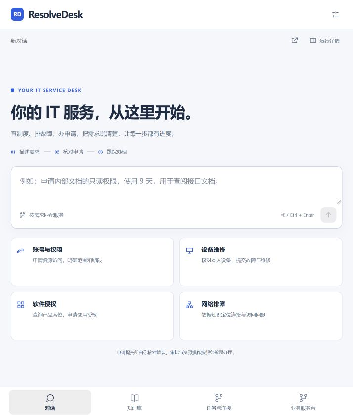
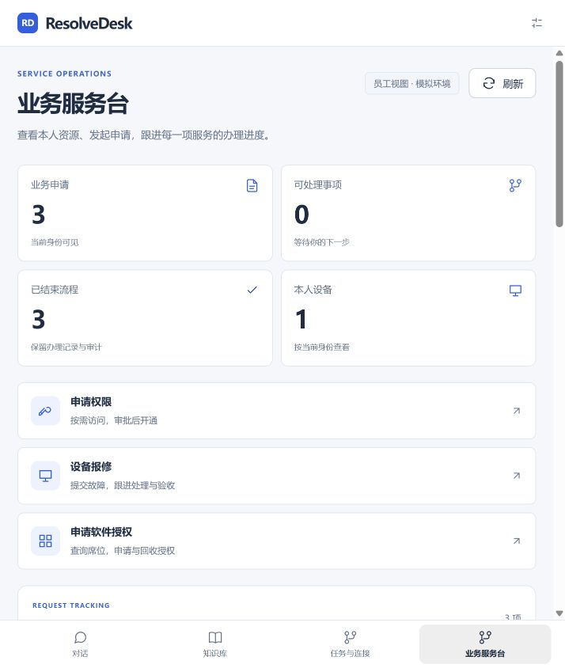
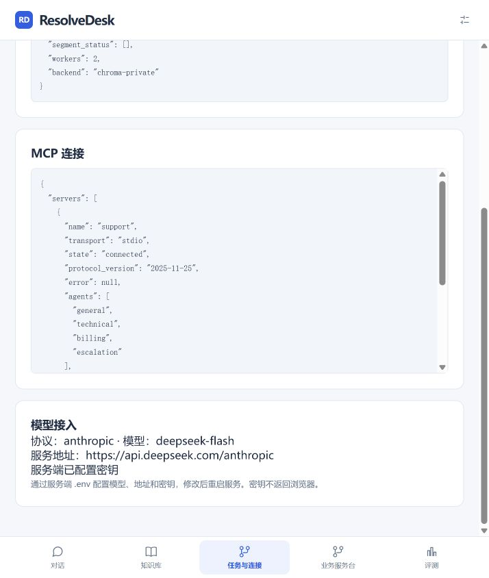

# 模型配置与身份边界验收

2026-10-29

## 本次行为

- 正常运行链使用`core.model_client.ModelClient`，支持Anthropic Messages与OpenAI Chat Completions兼容协议。模型、地址、密钥通过服务端`.env`配置；support可查看脱敏状态，修改配置后重启生效。
- 移除运行时累计费用上限、费用预留及旧开发开关依赖；保留单次执行超时、工具步数与输出长度边界。历史财务模块和2315条旧记录保留，旧记录的保守累计承诺仍为10.775836元；新运行链不写入该账本。
- `/me`角色绑定当前令牌与服务地址。员工与support的导航、知识管理、评测、监控和连接状态分别显示；切换身份后迟到响应不能恢复旧权限。
- 新执行检查点、检索缓存与评测快照包含模型身份；服务/协议/模型改变时不能混用旧执行。换同服务密钥不改变模型身份。
- 修复反馈候选与转回归接口的跨用户私有会话暴露、员工直接查看MCP管理状态、系统知识计数越界和未受派操作员的错误按钮。

## 本地验证

| 范围 | 结果 | 证据 |
| --- | --- | --- |
| 真实PostgreSQL/Redis/Chroma全量回归 | 482 passed，14 subtests passed；两条现有websockets弃用提示 | [最终XML](../reports/model-config-roles-enterprise-tests.xml) |
| 随后新增的发布扫描用例与权限定向回归 | 6 passed | `tests/test_release_scan.py`、`tests/test_enterprise_boundaries.py` |
| Vue行为与构建 | 50 passed，Vite构建成功 | `frontend/tests/`；产物`index-CcCVSd1q.js` |
| 宿主机8080与Docker网关18080 | 40/40；两端ready，配置脱敏、管理权限、本人监控、前端资源一致 | [部署检查](../reports/model-role-deployment-20261029T090619792100Z.json) |
| API/CLI与上传边界 | 11/11 | [API/CLI](../reports/api-cli-deployment-20261029T090322103513Z.json) |
| 标准MCP协议、隔离与真实stdio | 11/11 | [MCP](../reports/mcp-deployment-20261029T090322880807Z.json) |
| 依赖与发布检查 | 宿主机/容器pip check通过；发布密钥扫描零发现；依赖审计没有当前运行配置内的active finding | `tools/check_dependencies.py`输出保留Chroma上游风险及受验证配置排除项，不将其描述为上游修复 |

部署的业务源码来自`f08f3782d83ea114d8e4236756372ab55ba85614`；此后交付只增加验收工具、文档、测试记录和截图。Docker镜像revision标签保留该业务源码版本。本轮没有重跑收费Flash质量评测，也没有重新办理真实模型业务演示。

## 浏览器验收

以本地learner/support演示令牌分别检查：员工知识库没有导入/审核/Skills重载；员工服务台显示本人资源与记录且无租户监控；support恢复管理入口和模型脱敏信息；从评测页面切回员工立即回到对话并隐藏评测入口。全部为读取和身份切换，未发送聊天、运行评测或改变业务单据。

## 免费模型请求

新增密钥仅保存在本地，活动模型仍为原DeepSeek Flash。对OpenCode官方当前Chat Completions端点分别发送一次纯合成文本请求：`beam-free`返回403 `RegionError`，`big-pickle`返回429 `FreeUsageLimitError`。没有自动重试、切换付费模型或绕过提供方限制。函数工具和流式阶段未执行，不能称这两个模型已接入成功。

证据：[免费模型请求](../reports/free-model-probe-20261029.json)。之前失败的回归报告保留；`model-config-roles-services-tests.xml`含旧费用闸门连线断言失败，后续`-r2`及最终XML已通过。首版部署检查误将短布尔配置当成密钥而失败，修正检查为实际长凭据后40/40；两份原始结果均保留。

企业供真实员工使用前的必要补齐项见[企业使用边界检查](ENTERPRISE_READINESS.md)，重点是身份撤销、职责分离和外部系统执行一致性。测试通过不表示这些未实现的生产能力已经具备。
